# 按范围验证安全需求：开发计划

日期：2026-10-22
状态：P0 章节/控制选择闭环已实现并进入验收；其余条目仍为目标设计，不代表全部已经上线。
适用项目：PAthena。首个标准仍为 PCI DSS，不扩展新的合规标准。
修订说明：范围选择只限定安全需求实现检查的目标；不新增会跳过威胁建模或独立漏洞审计的“专项模式”。

## 1. 目标与执行边界

用户可以选择 PCI DSS 的章节、条款、固定控制或后续支持的安全主题，系统据此确定“哪些安全需求需要检查实现”。范围是结构化数据，保存在数据库和运行快照中，不能只写进 Prompt 或用于页面过滤。

完整分析仍保留四个阶段：

| 阶段 / 输出 | 范围选择带来的行为 |
| --- | --- |
| 安全需求 | 继续正常分析设计文档、生成安全需求、匹配相关合规控制并复核；保留完整需求及来源，标出哪些进入本次实现检查 |
| 威胁模型 | 继续按原有代码分析流程建模；不因需求范围缩小而减少目标、裁剪输入或跳过 |
| 需求实现情况 | 仅对选中范围内、与项目相关的需求及其全部验收项创建实现检查任务；保留必要共享代码和跨章节支持调查 |
| 安全风险 / Findings | 继续按原有代码审计流程独立扫描；范围外风险仍报告，不能要求每个 Finding 都绑定所选需求 |

核心约束：

1. **需求检查范围与分析阶段开关独立。** 相同运行模式、仓库及配置下，改变需求范围不能改变威胁建模/独立审计的阶段计划、代码范围和技能方法。
2. 预生成控制、规范原文、双语内容与已有向量继续使用。选择不同范围不重新生成控制或向量化标准。
3. 范围内候选由目录和选择规则完整枚举，不能由语义召回 top-K 决定必查清单。
4. “未选中”“与项目无关”“条件未定”“无法通过代码验证”“未完成/失败”分别记录，均不能冒充代码符合。
5. 安全需求、实现判断一一对应；未选需求保留在需求输出中，不伪造 Assessment，不删除原始需求。
6. 当前纯静态边界不变，不执行目标程序、动态复现或沙箱验证。
7. 范围检查的完整性不等于 PCI DSS 正式适用性结论，更不等于整个项目或组织通过合规验证。

## 2. 现状核对与缺口

| 模块 | 目前已有 | 本次需要补齐 |
| --- | --- | --- |
| 标准控制 | 固定 ID、条款 ID、控制类型、验证方式、原文片段、双语验收项 | 章节层级、受控主题/对象、分类来源及版本、依赖关系 |
| 预计算目录 | `prepared.json`、双语控制、规范与控制向量、目录摘要和本地重排 | 范围元数据、不可变身份、范围索引、资产级向量复用 |
| 检索 | `section` 可限制候选条款，但先读取/打分全目录再过滤 | 在范围查询入口先限制候选再召回/重排；保留不受实现范围约束的原有查询入口 |
| 项目匹配 | 按设计需求创建 mapper 任务并绑定命中控制 | 保留原流程，补充所选控制全量核对，防止设计未提及的必查控制消失 |
| 运行 API | `full`、`requirements_only`、`code_only`、`implementation_only` | 在适用模式增加需求检查范围参数、预览、冻结清单和服务端校验；不新增模式 |
| 调度 | 逐需求创建复核和实现任务 | 复核保留原范围；在实现任务分发处应用冻结目标，建模/审计不应用该过滤 |
| 历史复用 | 同项目已提交需求及来源可作为基线 | 保留完整基线和关系，单独选择本次复查子集，不把旧代码结论冒充新检查 |
| 页面与报告 | 四阶段、逐验收项实现状态、来源/代码位置、中英文、HTML/CSV/JSON | 完整需求与检查子集并存、未选状态、两类覆盖边界及阶段消费 |

现状定位：`standard_controls.py`、`control_catalog.py`、`standard_library.py`、`api.py`、`runtime.py`、`baseline.py`、`migrations.py`、`product_report.py`、`apps/web/src/App.tsx`。

## 3. 产品行为与优先级

### 3.1 完整分析中的需求范围

保留原有完整分析入口，在“需求实现检查范围”中选择“全部”或具体范围。完整需求列表继续展示，选中需求进入第三阶段；未选中的需求显示“未纳入本次实现检查”。

示例：用户选择 PCI DSS 中一个章节。系统仍从设计提取项目安全需求、正常建立威胁模型并进行独立漏洞审计；第三阶段只验证关联该章节的需求。独立审计发现其他章节或没有标准关联的安全风险时，照常保存和展示。

本次不引入与范围绑定的新阶段开关。既有 `implementation_only` 本身用于复查已有需求，是否运行其他阶段仍由原模式决定；不能把这种行为推广成“选范围就跳过建模/审计”。

### 3.2 分批交付

- **P0**：固定标准版本/目录，选择章节、子章节、条款或明确控制 ID；完成库存、关联、实现检查子集、报告和完整流程回归。
- **P1**：受控双语安全主题，与章节交叉选择；验收漏标、错标和未知处理。
- **P2**：适用对象、验证责任，以及项目生成需求的主题标签/明确需求 ID 子集复查。

省略范围保留现有行为。“全部”包括本次项目实际生成/绑定且需要实现检查的全部需求，不等于标准库全部控制都适用于本项目。按标准章节筛选时，没有可靠标准关联的设计需求不自动归章，保留在完整需求输出中。

## 4. 标准准备时的范围元数据

| 维度 | 来源与约束 |
| --- | --- |
| 标准身份 | 标准 ID、版本、`library_id`、`catalog_id`；不得跨目录拼接控制 |
| 章节树 | 原始编号、父子关系、顺序和双语名称；检查孤儿/循环 |
| 控制身份 | 稳定控制 ID、所属条款、原文引用；不因语言或标签改变含义 |
| 安全主题 | 受控 ID 和双语名称，允许多标签；如认证、授权、会话、日志、数据保护 |
| 适用对象 | 规范所约束的对象类型；不能预设具体项目实际存在这些对象 |
| 验证责任 | CODE / DEPLOYMENT / NON_CODE，保持与控制类型一致 |
| 适用条件 | 规范原文、双语条件和明确的时间条件；保留来源，不能编造生效日期 |
| 依赖关系 | 定义、父级限定、例外、必要控制依赖、仅相关；记录原文依据与目标 ID |
| 分类信息 | 分类版本、规则/模型来源、依据、已分类/未知/冲突；不只保存分数 |

具体项目的模块、入口、数据是否存在和实际职责，在项目分析时建立关联，不提前写死在标准库。

### 4.1 选择语义

- 同维度多值 OR，不同维度 AND；P0 仅启用章节/控制选择。
- 章节选择包含后代，父子重复去重；使用节点关系或路径段，不能把“8”前缀匹配到“80”。
- 明确控制 ID 与分类维度是互斥选择器，避免组合含义不清。
- 中英文名称/别名解析到相同 ID；输出语言不改变目标集合。
- 省略范围、显式全部、显式选择为空有不同语义；空选择拒绝，不回退全量。
- 非法 ID、跨目录 ID、非法组合必须报错，不能静默丢弃。
- 首版不支持任意散文条件、自由标签、任意布尔表达式或隐蔽排除规则。
- 固定控制一旦选中且相关，全部验收项进入处理，不按主题抽掉某几个验收项。

### 4.2 未知标签与正式适用性

章节/条款是硬身份，主题/对象是分类。P1 开始，冻结明确命中和可能命中但未分类/冲突的候选；未知候选不能直接当作范围外。

前置任务仅判断既有候选的分类/相关性，不生成控制；无法判断的条目保留未知并影响完整性。自动结算后提交不可变 `scope_resolution`，再创建实现检查任务，不增加人工审定要求。

分别记录：用户是否选中、是否与项目相关、正式适用条件是否满足、能否通过代码验证。部署/运营事实不可见不能变成无关；实际无关者可自动排除但保留具体原因。运行冻结评估日期，时间条件未知不得伪装已满足。

## 5. 候选、检查目标与支持依赖

维护以下集合，并分别保存身份和数量：

1. 用户选择命中的固定控制候选。
2. 对应的相关项目需求，以及范围归属/适用条件仍未定的项目项。
3. 最终本次实现检查目标：具体需求 ID 和其全部验收项 ID。
4. 判读和检查所需的支持上下文/控制依赖。
5. 完整需求输出中未纳入检查的其余需求。

支持闭包按有原文依据的引用、定义、限定和规范性依赖解析；检查循环、缺失和过大依赖。不完整必须显式记录，不能截断后宣称覆盖完整。主题相似只能是调查线索，不能扩大规范义务。

支持项可以触发必要代码阅读和目标相关调查，不自动进入独立需求的检查分母。授权机制可能位于共享中间件、调用方、数据层或配置中，需求范围不能变成源码硬读取边界。

上述集合仅用于需求分支。威胁建模与独立审计继续使用原有代码目标、上下文和工具权限；不套用需求目标/支持清单，不因 Finding 无法关联所选章节而拒绝入库。

## 6. 标准准备、目录版本与向量复用

准备流程：原始标准 → 结构化条款/上下文 → 固定控制 → 范围标签/依赖 → 结构校验 → 向量/词法资产 → 不可变目录发布。

继续采用独立标准准备任务，结果按确定契约校验再入库，不增加模型修补返回的隐式步骤。分类失败保持未知/未完成，不填假标签；技能参考资料不能当正式标准原文。

准备阶段检查控制责任是否原子化。当前对整条 DEPLOYMENT 控制有“无法通过代码验证”的快捷路径；混合了代码机制与实际部署义务的控制应离线拆成固定原子控制，保留共同原文/拆分关系，以新目录发布，避免代码部分被跳过。不能项目运行时临时改写规范或删除验收项。历史目录保持可读并显示其验证限制。

建议 prepared schema v2 → v3，增加范围元数据、分类/词表/依赖/策略版本及摘要：

- 元数据参与目录身份；只改标签/依赖时，相同模型 profile、文本配方与文本 hash 的向量可确定性复用。
- 正文、验收项、嵌入模型或文本配方改变时，重建受影响资产并发布新目录。
- 标签默认不混入向量文本；若后续加入，作为配方变化显式重算。
- v1/v2 继续可读；能从合法条款 ID 构建章节树时支持章节筛选。主题未准备时明确不可用，不退回全量。
- 新旧目录并列，校验后切换新运行；旧运行继续引用原目录，不原地覆盖。

当前 `preparation()` 在目录身份变化时重新遍历嵌入文本，需要实现资产级复用，而不是只给元数据加字段。

## 7. 数据库与不可变快照

复用现有标准、控制、向量和绑定表，新增对象名称待实施时统一：

| 对象 | 内容与约束 |
| --- | --- |
| `standard_scope_nodes` | 章节树、目录、原始顺序、双语名称、引用完整性 |
| `scope_taxonomies/scope_labels` | 受控维度、标签、双语别名、版本 |
| `control_scope_labels` | 目录内真实控制与标签、分类状态/依据/版本 |
| `standard_control_relations` | 控制/上下文依赖类型、原文依据、引用完整性 |
| `scope_resolutions` | 请求、候选、依赖、选中需求/验收项、未知项、版本/摘要；提交后不可改 |
| `run_control_inventory` | 候选控制的选择原因、相关性、适用性、职责、绑定和处理状态 |
| `run_scope_links` | 控制到需求/模块实例/实现任务的关联；Finding 关联可选，不能成为其入库条件 |
| 向量复用索引 | profile、文本配方、文本 hash、向量 hash/位置 |

运行快照保留原模式和代码分析配置，新增独立的 `requirement_check_scope`；不要用通用 `scope` 字段默认约束所有阶段。范围解析摘要进入实现任务身份与幂等键，原运行幂等键仍覆盖全部输入。

数据库保存完整需求集及本次选中关系。未选需求没有本次 Assessment，展示为“未纳入本次实现检查”；不能伪造 NOT_APPLICABLE/通过/失败记录。历史需求、Review、Assessment、Finding 和原始模型返回均保留。

## 8. 检索、技能和调度

### 8.1 范围检索

针对需求范围的查询执行：目录校验 → 确定性枚举 → 候选集合内向量/词法召回 → 融合 → 重排 → 分页 → 读取原文。

范围查询的所有检索路线、分页与控制展开遵守相同集合；不全库 top-K 后再筛，不空结果回退全库。库存不受相似度阈值影响。支持依赖有单独授权和标识。

查询向量缓存按相同 profile/文本复用；排序缓存包括目录、候选集合摘要、语言、配方及重排 profile。少量控制可直接从固定目录读取，不为使用向量额外发请求。

原有设计需求匹配和独立分析的查询入口保留其既有目标；不能给所有工具注入统一的章节限制。服务器按调用任务所属分支执行策略。

### 8.2 工作流与完整性

```mermaid
flowchart TD
    A[设计文档] --> B[正常提取安全需求及匹配相关合规控制]
    B --> C[完整需求集及来源]
    S[标准目录与用户需求检查范围] --> P[枚举所选控制并核对关联完整性]
    C --> P
    P --> T[冻结选中需求与全部验收项]
    R[代码快照] --> M[原流程威胁建模]
    M --> I[选中需求的实现检查]
    T --> I
    R --> V[原流程独立漏洞审计]
    M --> V
    I --> V
    C --> O[四项完整输出及分支覆盖说明]
    M --> O
    I --> O
    V --> O
```



图中的阶段前置关系沿用现有工作流；范围解析只新增实现任务的目标筛选。不得以选择范围为由跳过原建模、索引或审计节点，不改变原代码切分、调查和审计技能。

完整需求生成、关联和复核按原方法运行；所选控制再全量核对，避免“设计没提就没有对应需求”。缺少设计需求关联但确实相关的控制，可根据固定控制与项目职责原样绑定为需求，原始设计链接允许为空；不伪造设计 Requirement。与项目无关、未知和未绑定原因都进入台账。

当前固定绑定遍历 `requirement_ids`，为空会零产出，须增加控制驱动的绑定协议；保留旧设计关联路径的来源约束。固定正文、条件、双语验收项和版本原样保存，项目相关性判断另存，不调用旧生成器现场创造标准控制。

实现任务只能来自冻结目标；每个目标的全部验收项有且仅有对应结果。范围未定项按明确策略保留待定，不能记为完成。范围外需求不创建实现任务，但其事实/背景仍可被建模和独立审计使用。

有效选择最终没有相关可检查需求时，第三阶段明确显示零项及原因，调度器仍按原计划继续建模/独立审计，不能因没有实现子任务而误判整个流程无需执行。范围解析只阻挡对应实现任务，不增加建模的全局前置依赖；实际错误仍按既有错误处理契约记录。

独立审计继续读取完整需求背景。对未选需求缺少 Assessment 只能解释为本次未做需求实现检查，不能解释为已实现或要求无关；审计可以自行发现相关问题。实现检查与独立审计产生相同风险时沿用去重/关联机制并保留来源，不以章节不符丢弃独立发现。

本次不因范围功能而拆出一套跳过建模的索引初始化。既有 `implementation_only` 若需改善导航初始化，属于该模式自身缺陷修复，另行列项，不能作为改变完整分析的理由。

### 8.3 技能与服务端约束

- 设计分析、需求生成和复核：保留完整专业方法，不被实现范围裁剪。
- 标准匹配：补全所选控制的候选核对和相关性调查，保留完整需求关联，不删除范围外已有需求。
- 实现检查：加载选中需求及完整验收项，允许必要上下文和共享代码调查；不扩大独立检查目标。
- 历史标准生成：仅兼容用途，新功能不现场生成固定控制。
- 原生建模/审计技能：不改正文、不施加需求章节过滤、不要求只报告选中需求相关风险。

所有应用技能变更落入仓库及 manifest，正式与评估使用同一全文/加载器。

拟新增 `scope_policy.py`、`scope_resolution.py`，共用于预览、创建、范围查询、绑定核对、实现任务分发、提交及导出。约束按分支适用，不能全局拦截范围外 Finding。模型返回缺项、冲突或越界实现结果时拒绝提交并保留原返回，不调用另一个模型修补。

## 9. API、前端与模式兼容

### 9.1 接口契约

- `GET /api/v1/standards/{catalog_id}/scope-options`：章节树、标签、分类完备性、可用维度。
- `POST /api/v1/projects/{project_id}/requirement-check-scope-preview`：确定性枚举/校验，返回控制、支持依赖、待判项、规模和 `preview_hash`；不调用大模型、不读取源码正文。
- 创建运行请求新增 `requirement_check_scope`，沿用现有 mode；创建时检查目录/预览身份，冻结范围。
- `GET /api/v1/projects/{project_id}/runs/{run_id}/requirement-check-scope`：请求、候选、解析、选中需求/验收项、去向与进度。

目标请求示意，示例 ID 不是实际标准条款：

```json
{
  "mode": "full",
  "repository_id": "registered-repository",
  "requirement_check_scope": {
    "catalog_id": "immutable-catalog-id",
    "selector": {
      "kind": "facets",
      "standard_node_ids": ["node-from-catalog"],
      "topic_ids": [],
      "responsibility_ids": []
    },
    "preview_hash": "hash-returned-by-preview"
  }
}
```

没有新 `scoped_verification` 运行模式。预览只枚举标准候选，相关项目需求及实际可检查项要到分析后确认，不能把预览控制数冒充最终需求数。

预览后目录身份不一致、未知 ID、空选择或非法组合须明确拒绝，不改用最新目录继续运行。已有旧目录仍可被明确选用；默认设置变更不静默替换已提交目录。默认预算沿用现配置，不恢复 API/token 上限。

### 9.2 模式矩阵

| 模式 | 需求检查范围参数 |
| --- | --- |
| `full` | 支持；只筛实现检查目标，四阶段保持原计划 |
| `implementation_only` | 支持；在已有完整基线中选择复查目标，不自动新增建模/审计，也不改变原模式职责 |
| `requirements_only` | 首版拒绝实现检查范围，避免未执行检查却显示已验证；以后如需需求目录筛选另设明确字段 |
| `code_only` | 拒绝，没有基于标准/设计的需求实现检查；代码分析按原模式执行 |

### 9.3 页面行为

在现有分析配置中增加“需求实现检查范围”：全部 / 选择标准章节。保持现有模式和四阶段导航，不增加“专项”独立入口。P1/P2 逐步增加主题、对象、责任与已有需求选择。

需求页面展示完整需求及本次检查标记，可按“已选/未选”筛选；实现页只列目标及待定/排除说明。威胁模型和安全风险页保持原结果范围，不能跟着需求筛选隐藏结果。

报告摘要同时显示“需求实现检查范围”与“代码建模/审计范围”。不要用一个全局“本次仅检查第 X 章”误导用户。中英文用同一 ID，遵循运行语言，不重译历史结果；不暴露 catalog/hash 参数或恢复晦涩的公共证据入口。

## 10. 基线、恢复与历史兼容

- 同项目已提交基线保留完整需求、来源、关联和原目录；选中子集单独保存，不删除基线的其余需求。
- 复制必要事实/标准/关联闭包，维持旧新 ID 映射，不能留下悬空关系。
- 基线没有所选控制时，明确“基线未包含”，不算已检查；补齐控制需要走具备相关性分析的完整流程，不能在纯复查时悄悄创造需求。
- 未关联标准的设计需求不因标题相似自动归章。P2 支持其项目主题或明确需求 ID 选择。
- 新代码快照重新检查实现；默认不复用旧 Assessment/Finding 作本次结论。
- 改变检查范围创建新运行；暂停/重试/恢复继续使用原目录、范围、技能和工作流，版本不可用则明确阻断，不混用新版。
- 第一版不做跨运行结论复用；允许确定性解析/向量/索引资产按完整身份复用，不直接继承旧模型结论。
- 新字段是独立分支配置；旧运行无此字段时保持原全量实现检查，不回填伪造范围。

## 11. 覆盖统计与报告

标准控制按唯一 `catalog_id + control_id` 计数；实现任务按需求/模块实例/验收项计数。一个控制多个模块都需结算，不能用一个模块通过代表全部。

报告包含：

1. 完整安全需求及来源；本次选中/未选标记。
2. 所选控制库存、相关性、适用性、排除/未知/失败及具体原因。
3. 选中需求全部验收项的实现结果和实际代码位置。
4. 无法通过代码验证的相关部署/运营要求。
5. 原代码范围的威胁模型和独立安全风险，包含未关联所选需求的发现。
6. 各阶段执行状态、覆盖边界与消费，禁止用需求选择缩窄独立发现报告。

分开统计：

- 候选结算：相关、无关排除、未定、未完成/失败互斥归类，合计与库存相符。
- 实现检查完成度：已提交终态验收项 / 本次应检查验收项；UNKNOWN、NOT_CODE_VERIFIABLE 不算静态支持。
- 未选需求：独立计数，不进入本次实现检查分母，也不叫不适用。
- 静态支持率：仅针对范围内可检查对象，显示未知/外部项，不称合规通过率。
- 建模/独立审计：使用原有自己的阶段状态和覆盖信息，不使用选中需求数作分母。

零相关代码要求、只剩外部要求或未完成，不显示“100% 合规”。HTML/CSV/JSON/页面使用同一产物，导出不额外调用模型归纳，不丢失未选/未知/范围外独立风险。

## 12. 消费与性能验证

预期节省主要来自第三阶段：不向实现检查器提交未选需求、不调查其专属代码、不创建其验收任务。所选控制的全量核对、依赖补读也有成本。不得把跳过完整建模或独立审计计算成范围选择收益。

设计需求分析、正常合规匹配、需求复核、建模和独立审计仍按原流程执行，不能承诺总消费按章节数同比下降。由于模型调用存在波动，各轮实际 token 不必相同；验收的是计划、输入边界、技能及审计方法不受需求选择裁剪。

按阶段记录输入/输出、供应商缓存、已知/在途/未知用量与重试；未知不填零。比较总消费、实现分支消费和范围核对额外消费，避免只报局部节省。未校准前预览只显示规模，不显示伪精确 token 报价。

对照冻结设计/源码/标准/模型参数/语言/技能，比较全部、单章、小条款集和依赖较多的集合；保留失败及所有重试成本。确定性检查完整流程阶段计划不变，真实模型评估范围内漏查、误排和实际消费。不能为省费裁掉技能正文、规范条件或验收项。

## 13. 开发工作包

| 阶段 | 工作 | 完成门槛 |
| --- | --- | --- |
| M0 契约与样本 | 范围字段、模式矩阵、集合/台账、分支隔离、依赖策略 | 固定预期控制/需求清单，完整四阶段计划不受选择影响 |
| M1 标准与数据库 | schema v3、章节树、分类/依赖、迁移、向量复用 | 旧目录可读；不变文本向量复用；坏引用/篡改拒绝 |
| M2 P0 后端 | 预览/冻结、控制全量核对、直接绑定、实现任务筛选、分支校验 | 单章只减少实现目标；原建模/独立审计照常执行，范围外发现可入库 |
| M3 P0 页面/报告 | 范围配置、完整需求与子集、两类边界、导出/基线 | 未选、排除、外部、未知正确区分；双语和四种输出一致 |
| M4 验收/上线 | 完整流程回归、故障恢复、真实模型成本/质量、并列目录切换 | 硬验收通过，保留迁移/回退记录，实验不污染生产 |
| M5 P1/P2 | 主题/对象/责任、未知分类、项目需求标签与 ID 子集 | 分类召回/未知处理单独验收后启用 |

顺序 M0 → M1 → M2 → M3 → M4；M0/M1 预留扩展契约，M5 再交付分类选择。服务端范围约束和分支隔离不能等页面完成后再补。

文件落点：

- `standard_controls.py`、`ingestion.py`：元数据、schema、兼容、向量资产复用。
- `migrations.py`、`store.py`、`standard_library.py`、`control_catalog.py`、`retrieval.py`：范围索引、目录/查询身份、控制绑定和台账。
- 拟新增 `scope_policy.py`、`scope_resolution.py`：统一选择、依赖、冻结、按分支校验。
- `api.py`、`domain.py`、`config.py`：新增请求字段、现有模式校验、响应和默认行为。
- `runtime.py`、`agents.py`、`design/workflow.json`：仅给实现分支增加目标解析/筛选依赖，不取消或收窄原建模/审计节点。
- 应用技能及 manifest：所选控制完整核对、绑定及实现协议；原生技能正文不改。
- `baseline.py`：完整基线关联和复查子集，不复制旧实现结论。
- `product_report.py`、结果矩阵、`apps/web/src/App.tsx`、双语消息：未选状态、分支范围与统计。
- `tests/`：确定性边界/库存/迁移/阶段不变测试；独立本地实验保留真实模型原件。
- `README.md`、`README.en.md`：能力边界和实际测试结果，不宣称整个扫描被限定到所选章节。

不把拆分原生代码索引初始化或重构审计引擎列为本次范围功能的必需工作。

## 14. 验收矩阵

### P0 硬验收

1. 所选章节目录预期控制 ID 与库存逐一一致，未命中语义召回或设计未提及者仍有明确去向。
2. 父子重复、相近编号、附录、多章、明确控制、非法/跨目录 ID、空选择行为确定。
3. 需求输出保留完整集，未选需求显示未纳入检查，不删除、不伪造 Assessment。
4. 只给选中相关需求创建实现任务，全部验收项各有对应结果；多模块不能部分通过代表全部。
5. 部署控制保留且无法代码验证；混合责任新目录原子化；无关有理由，正式条件未知不伪装通过。
6. 必要定义/例外/跨章节依赖可读取；缺失/循环/不完整明确留痕，支持项不扩大独立目标分母。
7. 范围查询、绑定、实现分发/提交/分页不能逃出目标及支持集合；不把这些限制施加给独立审计。
8. 相同 `full` 模式及源码配置下，全量/窄范围的建模与独立审计阶段均执行，代码目标、技能及原生切分策略不变。
9. 独立审计提交范围外或无需求关联的 Finding，仍成功入库、展示及导出；完整威胁模型不被需求筛选隐藏。
10. 预览/创建竞态、重复请求、暂停/恢复、API 失败、重试、进程重启保持原范围与分支计划。
11. 旧运行/目录/报告/模式兼容；不新增按范围自动跳阶段的 mode，不恢复 API/token 限额。
12. 元数据变更复用不变文本向量；正文/模型/配方改变形成新身份，历史目录不覆盖。
13. 页面/HTML/CSV/JSON 的完整需求、选中目标、未选/未知/外部和全部独立风险一致；零目标不显示全通过。
14. 中英文目标 ID 相同；不新增目标执行权限、不改原生技能正文、不用测试专属技能。
15. 隔离环境完成完整四阶段真实模型对照；分别报告实现分支和全流程消费，实验材料/密钥不入库。
16. 有效范围没有相关可检查需求时，第三阶段准确结算零项，原定建模/独立审计照常执行；缺少未选需求的 Assessment 不被当作已实现。

### P1/P2 额外验收

- 标签错标/漏标/未知/冲突及别名；未知不自动当无关。
- 初始候选和最终 resolution 可重放，实现检查开始后目标不变。
- 跨维度 AND、维度内 OR、互斥选择器、项目主题/明确需求 ID 正确。
- 无标准关联需求不伪造章节；基线缺项、悬空关系、代码变化和范围变化有正确处理。
- 至少一个未参与方法调优的真实项目做独立漏查/误排复核，开发样本不称盲评。

## 15. 上线、回退与风险

上线：兼容迁移 → 并列目录 → 离线校验 → 实现分支/API → 页面 → 隔离实验 → 启用。生产目录不原地重建，原分析结果保留。

按功能开关关闭新选择入口，不能删除已冻结范围或使存量窄范围任务退回全量。需回退 worker 时先妥善处理新字段运行，不能让不理解范围的旧 worker 恢复。保留兼容数据库/目录和完整四阶段行为。

| 风险 | 应对 |
| --- | --- |
| 范围被误当阶段开关 | 独立字段、既有 mode、阶段计划不变回归 |
| 范围过滤误伤建模/独立发现 | 按任务分支应用策略，测试范围外 Finding 入库/导出 |
| 语义召回漏要求 | 确定性枚举、所选控制逐项核对 |
| 标签漏标导致假完整 | 未知候选保留、分类单独验收，先交付章节 |
| 依赖缺失或源码读取过窄 | 原文支持闭包、共享代码调查、缺上下文显式未知 |
| 未选被写成无关/通过 | 独立选择状态，无伪造 Assessment |
| 固定控制被改写 | 原样绑定、不可变目录、验收项库存校验 |
| 旧缓存/基线污染结论 | 完整身份、复查子集、默认不复用代码结论 |
| 总体节省被夸大 | 阶段及总量分别计费，不把跳过审计算收益 |
| 统计被解读成合规认证 | 正式适用性、静态支持、外部事实和完成度分开 |

完成标准：用户能看到全部安全需求和完整代码分析结果，同时明确知道哪些需求进入本次实现检查、各项结论的代码依据及无法验证之处；改变需求范围只改变需求实现检查目标，不改变威胁建模与独立漏洞审计的职责。


## 本轮实现记录（P0）

- 已实现章节/条款/控制选择、范围预览与冻结、所选控制完整核对、缺少设计关联时的固定绑定、实现任务筛选、完整基线子集复查、页面及三种导出。
- 完整需求保留；原建模/独立审计节点与原生技能不变，范围外独立发现继续保存。
- 数据库迁移至 v6。章节元数据由已有不可变控制的条款身份确定性派生并持久化，兼容既有 prepared v1/v2；本轮不强制重建为 v3。
- 标准准备已增加相同 profile/文本配方下的资产级向量复用。
- 当前支持标准原始 source.context_ids；跨条款语义依赖、主题/对象/责任分类、混合责任控制离线原子化和真实模型成本/质量对照仍待后续验收，不把这些能力写成已完成。

验收记录：319 项自动化测试通过，前端构建和原生技能语料校验通过。真实历史数据库副本及本机升级后均保留 9 项目、26 运行、2,020 记录和 342 条旧用量记录。浏览器完成真实目录条款选择/预览；未启动新的模型分析。该记录不代表真实模型质量或消费节省的验收。
